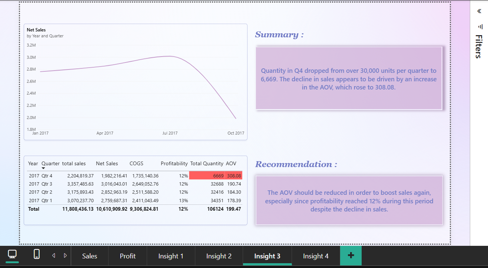
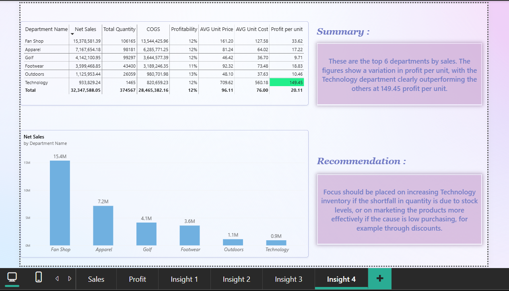

# Supply Chain Analysis Dashboard

An analysis of the DataCo Smart Supply Chain dataset, using Excel (Power Query) for data cleaning and Power BI for building an interactive dashboard with data-driven insights.

## Project Overview

This project covers a full data analysis workflow:
1. **Data Cleaning** using Excel (Power Query)
2. **Interactive Dashboard** using Power BI
3. **Insights & Storytelling** pages highlighting key findings from the data

## Tools Used

- **Excel (Power Query)** - Data cleaning and transformation
- **Power BI Desktop** - Dashboard building and DAX calculations

## Data Source

The raw dataset (DataCo Smart Supply Chain for Big Data Analysis) was sourced from Kaggle:
[DataCo Smart Supply Chain Dataset](https://www.kaggle.com/datasets/shashwatwork/dataco-smart-supply-chain-for-big-data-analysis)

**Note:** Due to file size limitations on GitHub, only a sample of each cleaned table is included in this repository. The full dataset is available at the Kaggle link above.

## Data Cleaning (Power Query)

**DataCoSupplyChainDataset**
- Used first row as headers
- Corrected column data types
- Replaced null values in the `Order Zipcode` column with zeros and adjusted its data type
- Applied rounding to several numeric columns

**DescriptionDataCoSupplyChain**
- Used first row as headers
- Corrected column data types
- Replaced specific values (Replace Value)
- Removed extra whitespace (Trim)

**tokenized_access_logs**
- Used first row as headers
- Corrected column data types

## Dashboard (Power BI)

Built 6 interactive dashboard pages covering sales performance, profit, and key business insights.

## Power BI Measures

- **Total Sales**: Sum of all sales transactions
- **Net Sales**: Sales after accounting for discounts
- **COGS**: Cost of Goods Sold
- **Total Profit**: Sum of profit across all transactions
- **Profitability**: Total Profit divided by Net Sales (profit margin)
- **AOV (Average Order Value)**: Average amount spent per order
- **Total Quantity**: Sum of items ordered
- **% Late Delivery**: Percentage of orders delivered later than scheduled
- **AVG Unit Cost**: COGS divided by quantity
- **AVG Unit Price**: Net sales divided by quantity
- **Profit Per Unit**: AVG unit price - AVG unit cost

## Files in this Repository

| File | Description |
|---|---|
| `supply_chain_sample_dataset.xlsx` | Sample of the main cleaned dataset |
| `description.xlsx` | Cleaned description/reference table |
| `tokenized_access_sample.xlsx` | Sample of the tokenized access logs table |
| `supply_chain_dashboard.pbix` | Full Power BI dashboard file |
| `dashboard1_preview.png` | Sales Report dashboard preview |
| `dashboard2_preview.png` | Profit Report dashboard preview |
| `dashboard3_preview.png` | Insights: Sales trend and profitability by category |
| `dashboard4_preview.png` | Insights: Shipping mode and late delivery analysis |
| `dashboard5_preview.png` | Insights: Sales drop by year and quarter |
| `dashboard6_preview.png` | Insights: Sales and profit per unit by department name |

## Dashboard Previews

### Dashboard 1: Sales Report

### Dashboard 2: Profit Report

### Dashboard 3: Sales & Profitability Insights

### Dashboard 4: Shipping Mode Insights

### Dashboard 5: Sales Drop Insights

### Dashboard 6: Sales By Department Insights

## Key Insights

### Insight 1
**Summary:** Strength Training generates 49K in sales but only 1% margin, while Golf Bags & Carts achieves 19% margin on just 9.5K.

**Recommendation:** Strength Training's pricing or cost structure needs review despite its higher volume,and work on increasing sales of golf bags & carts.

### Insight 2
**Summary:** First Class shipping shows a 95.32% late delivery rate — the highest across all shipping modes and a critical issue requiring immediate attention.

### Insight 3
**Summary:** Quantity in Q4 dropped from over 30,000 units between Q1 and Q3 to 6,669. The decline in sales appears to be driven by an increase in the AOV, which rose to 308.08.

**Recommendation:** The AOV should be reduced in order to boost sales again, especially since profitability reached 12% during this period despite the decline in sales.

### Insight 4
**Summary:** These are the top six departments by sales. The figures show a variation in profit per unit, with the Technology department clearly outperforming the others at 149.45 profit per unit.

**Recommendation:** Focus should be placed on increasing Technology inventory if the shortfall in quantity is due to stock levels, or on marketing the products more effectively if the cause is low purchasing, for example through discounts.
