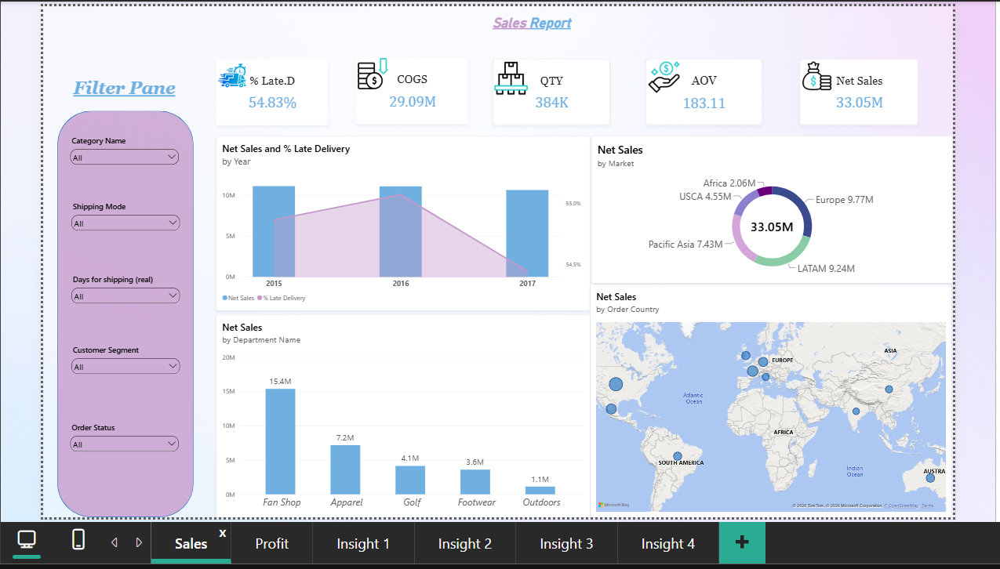
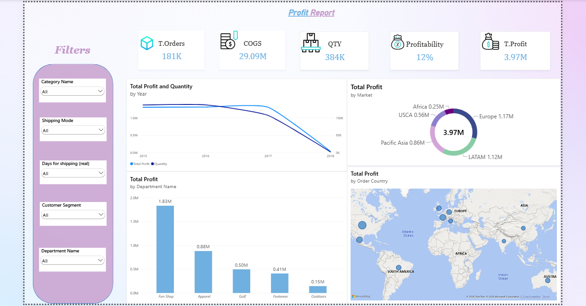
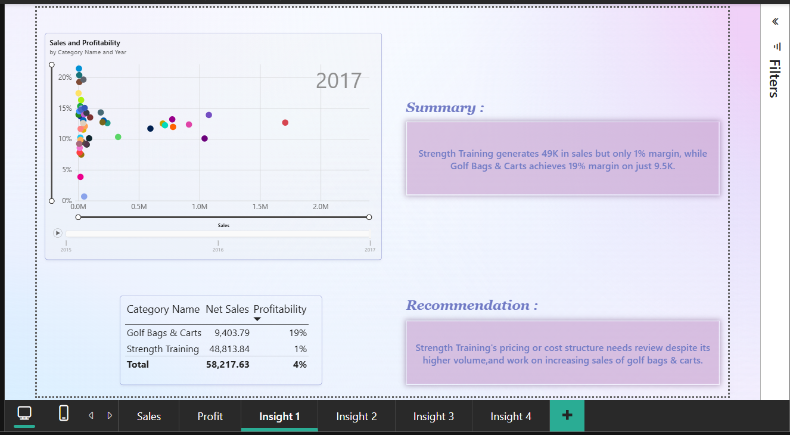
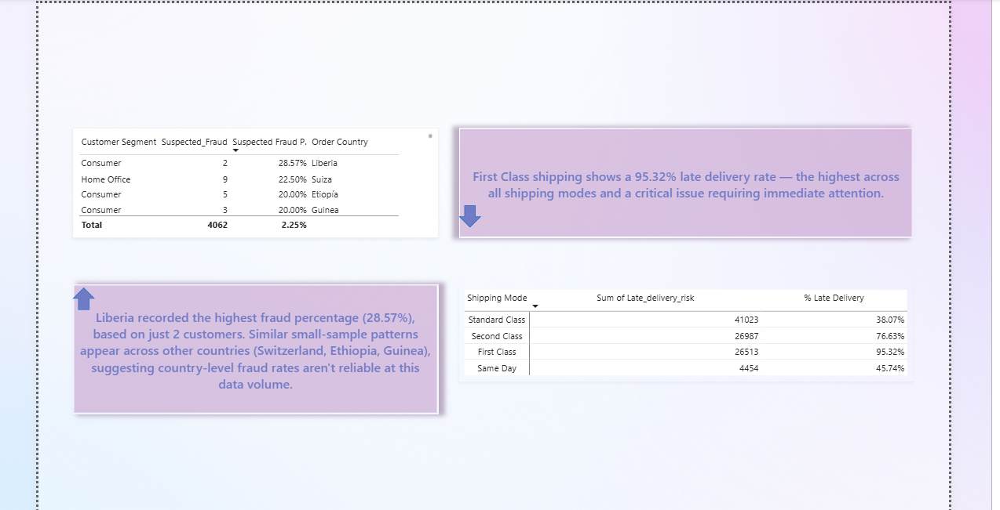

# Supply Chain Analysis Dashboard

An analysis of the DataCo Smart Supply Chain dataset, using Excel (Power Query) for data cleaning and Power BI for building an interactive dashboard with data-driven insights.

## Project Overview

This project covers a full data analysis workflow:
1. **Data Cleaning** using Excel (Power Query)
2. **Interactive Dashboard** using Power BI
3. **Insights & Storytelling** pages highlighting key findings from the data

## Tools Used

- **Excel (Power Query)** - Data cleaning and transformation
- **Power BI Desktop** - Dashboard building and DAX calculations

## Data Source

The raw dataset (DataCo Smart Supply Chain for Big Data Analysis) was sourced from Kaggle:
[DataCo Smart Supply Chain Dataset](https://www.kaggle.com/datasets/shashwatwork/dataco-smart-supply-chain-for-big-data-analysis)

**Note:** Due to file size limitations on GitHub, only a sample of each cleaned table is included in this repository. The full dataset is available at the Kaggle link above.

## Data Cleaning (Power Query)

**DataCoSupplyChainDataset**
- Used first row as headers
- Corrected column data types
- Replaced null values in the `Order Zipcode` column with zeros and adjusted its data type
- Applied rounding to several numeric columns

**DescriptionDataCoSupplyChain**
- Used first row as headers
- Corrected column data types
- Replaced specific values (Replace Value)
- Removed extra whitespace (Trim)

**tokenized_access_logs**
- Used first row as headers
- Corrected column data types

## Dashboard (Power BI)

Built 4 interactive dashboard pages covering sales performance, profitability, and key business insights.

## Power BI Measures

- **Total Sales**: Sum of all sales transactions
- **Net Sales**: Sales after accounting for discounts
- **COGS**: Cost of Goods Sold
- **Total Profit**: Sum of profit across all transactions
- **Profitability**: Total Profit divided by Net Sales (profit margin)
- **AOV (Average Order Value)**: Average amount spent per order
- **Total Quantity**: Sum of items ordered
- **% Late Delivery**: Percentage of orders delivered later than scheduled
- **Suspected Fraud %**: Percentage of orders flagged as suspected fraud
- **Suspected Fraud Count**: Count of orders flagged as suspected fraud

## Files in this Repository

| File | Description |
|---|---|
| `supply_chain_sample_dataset.xlsx` | Sample of the main cleaned dataset |
| `description.xlsx` | Cleaned description/reference table |
| `tokenized_access_sample.xlsx` | Sample of the tokenized access logs table |
| `supply_chain_dashboard.pbix` | Full Power BI dashboard file |
| `dashboard1_preview.png` | Sales Report dashboard preview |
| `dashboard2_preview.png` | Profit Report dashboard preview |
| `dashboard3_preview.png` | Insights: Sales trend and profitability by category |
| `dashboard4_preview.png` | Insights: Late delivery and suspected fraud analysis |

## Dashboard Previews

### Dashboard 1: Sales Report

### Dashboard 2: Profit Report

### Dashboard 3: Sales & Profitability Insights

### Dashboard 4: Delivery & Fraud Insights

## Key Insights

- Sales dropped sharply in Q4 2017, reversing the stable trend seen earlier in the year, warranting further investigation into potential causes (inventory, marketing, or market-specific issues).
- Strength Training generates high sales volume but only a 1% profit margin, while Hunting and Shooting achieves a 4% margin on far lower sales, suggesting a pricing or cost structure issue.
- First Class shipping shows a 95.32% late delivery rate, the highest across all shipping modes.
- Suspected fraud rates at the country level are based on very small sample sizes in some cases, making them unreliable indicators at this data volume.
